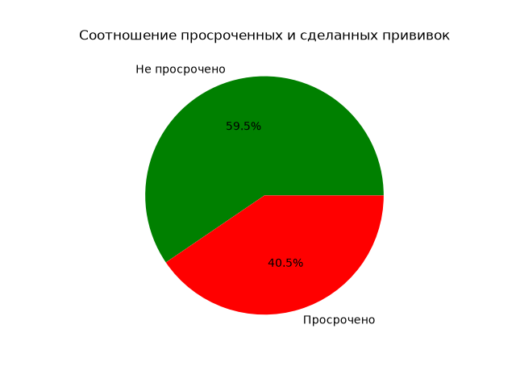
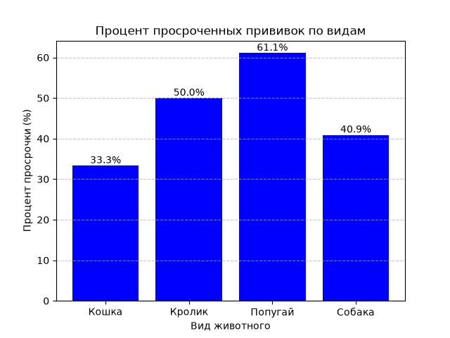
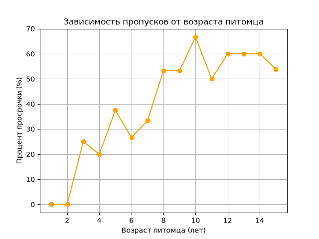
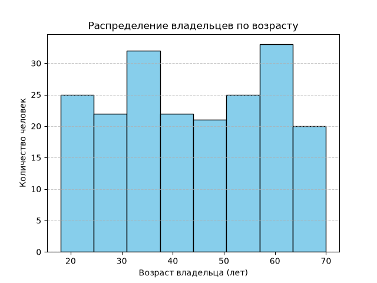
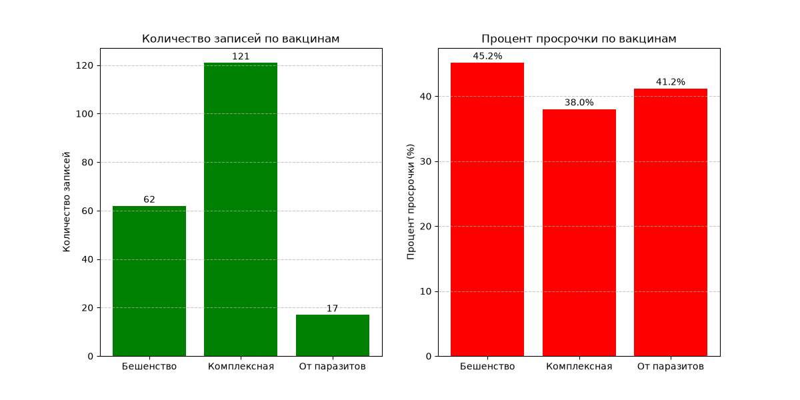

# Telegram-бот «Дневник питомца»

Учебный проект по Python. Бот с системой напоминаний о прививках.

## Анализ данных и обоснование полезности проекта

На основе сгенерированного датасета (200 записей) был проведен анализ, который доказывает, почему владельцам животных нужен этот бот.

### 1. Почти половина питомцев имеет просроченные прививки

**Вывод:** 40.5% питомцев имеют просроченную вакцинацию. Это значит, что почти каждый второй владелец забывает следить за графиком прививок. Мой бот решает эту проблему через автоматические напоминания в Telegram.

### 2. Владельцы кроликов и попугаев забывают чаще

**Вывод:** У кроликов и попугаев прививки просрочены чаще, чем у собак и кошек. Ветклиники реже напоминают о них, поэтому мой бот станет главным помощником для таких владельцев.

### 3. Чем старше питомец, тем меньше внимания

**Вывод:** У питомцев старшего возраста прививки просрочены чаще, чем у молодых. Владельцы теряют бдительность. Бот будет напоминать о вакцинации независимо от возраста животного.

### 4. Целевая аудитория — активные пользователи Telegram

**Вывод:** Распределение по возрасту показывает, что владельцы питомцев — это люди разного возраста, но пики активности приходятся на 30–40 и 55–65 лет. Так как Telegram популярен среди всех этих возрастных групп, формат бота будет удобен для большинства пользователей.

### 5. Какие прививки забывают чаще всего

**Вывод:** Бот будет отправлять уведомления по всем типам вакцин, однако данные показывают, что самый высокий процент просрочки приходится на прививку от Бешенства (45.2%) и обработку от паразитов (41.2%). Поэтому при настройке напоминаний этим критически важным процедурам будет уделяться первостепенное внимание, чтобы защитить питомцев от опасных заболеваний.
